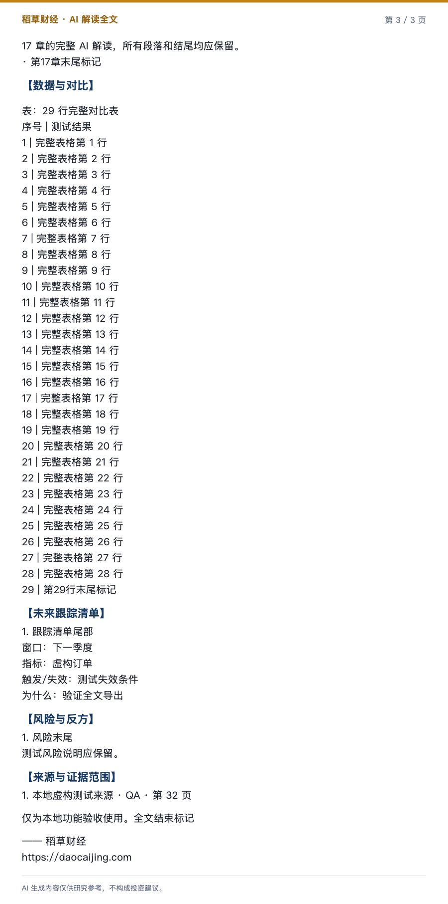

# AI 解读文字与完整图片导出（2026-10-12）

已发布到 https://daocaijing.com。刷新页面、重新打开解读后可使用“复制文字”和“复制完整图片”。

## 功能

- 新闻与研报解读窗口新增两个明确的复制按钮；资料库的解读编辑器、已保存解读，以及研报工作台的快速、视觉、专业解读和引用问答使用相同导出组件。
- 文字与图片共用正在阅读的解读正文。章节、长段落、表格全部行、跟踪项、风险与来源不再经过旧分享卡的数量或长度上限。
- 图片在本地生成，宽 900 像素、每张最高 2400 像素；较长解读按顺序分页，可逐张复制、下载 PNG，手机可长按保存。保留原微信摘要分享入口。
- 文字复制受限时提供可手动选择的全文；图片剪贴板不可用时保留预览与保存入口。只有剪贴板操作确认成功才显示“已复制”。
- 换号、切换正文、禁用、关闭或卸载会使旧导出失效，迟到结果不会重新显示或执行降级复制。关闭图片预览的 Escape 不会同时关闭原解读。
- 导出解读的已知展示字段，引用原文保持阅读器既有的 80 字证据定位摘要，不导出原始 API 对象。

## 验证

| 检查 | 结果 |
| --- | --- |
| 最新生产源码候选全量前端测试 | 54 套件、626 项通过 |
| 精确提交内容的隔离验证 | 5 套件、68 项通过 |
| 生产候选与提交候选 TypeScript | 均通过 |
| CRA 生产构建 | 成功，单个 React 运行时 |
| 浏览器实际文字复制并粘贴 | 5269 字符，文末标记保留 |
| 浏览器实际 PNG 复制并粘贴 | image/png，900×484，72200 字节 |
| 长文 PNG 编码与解码 | 3 张：900×2384、900×2374、900×1812 |
| 长文完整性 | 1800 字以上段落尾部、第 17 章、表格第 29 行及全文结尾均已绘制 |
| 320×780 小屏 | 预览无横向溢出，操作按钮高度 44 像素 |
| 线上浏览器 | 主包 main.f570cf5d.js；主页和 ontology 正常，无控制台错误 |
| 线上静态资源 | 161 个资源逐 SHA256 匹配；126 个上版独有静态资源保留 |
| HTTP 与鉴权 | 5 个公开页面/资源 200；服务回环 2 个私有入口 401 |
| 后端稳态 | ready=true；20 次 health 全部 200，最大 8.507ms |

首次全量测试有 3 个测试超过默认 5 秒上限。原因是 JSDOM 反复遍历整页 Ant Design 控件的可访问名称；优化测试定位与清理后，入口套件由 28.79 秒降至 5.72 秒。未放宽超时，最终重新完成了全部 626 项测试。

浏览器验收使用隔离 localhost 与虚构资料，真实生成、复制和粘贴，未触发生产付费 AI 调用或修改真实账户内容。小屏为浏览器视口模拟，未覆盖实体手机的系统剪贴板。IAB 的 data URL 下载自动化未返回下载事件；实际生成的 PNG 通过本地测试页证据按钮保存并逐页检查，产品仍提供标准下载链接和长按保存。

## 发布指纹

发布基于最新线上 main.357b82d5.js 对应冻结源码，保留刚上线的研报排版与财务分析功能。347 个源码输入中，336 个非本次路径逐字节保留；金融终端使用唯一块补丁，未整文件吸收主工作树的其它未提交修改。

- 主包：`static/js/main.f570cf5d.js`
- JS SHA256：`46067a64701bd9907f395408ce9ab245a88506c56b9233c03a8870339debaf15`
- CSS：`static/css/main.f6212050.css`
- CSS SHA256：`182aff4b97f3f38f6c9efce9cab4384b976a042c1f4f82862dfdda5eb5f6d33e`
- index SHA256：`40278004e2366756e35ae331d91537777cfb900a69b68a7bd69558abfd71f747`
- 备份：`/root/deepfocus-copy-export-web-20261012/web-before.tgz`
- 发布方式：锁内重核对 161 个基线资源，保留旧 chunks，叠加资源，最后原子替换 index。
- 本次仅发布前端。观察到的后端仍为 8301 / PID 1848751，release ID `7de1e692552372cc42ca130df3235ff36cb4b2a84545a9d1a991bef2d0851f8d`。

完整测试、源码与资源哈希、浏览器 PNG、发布回执位于：

`/Users/d-robotics/.codex/visualizations/2026/10/12/01a12e4e-e898-7a73-bbb9-4eb4411413d3/copy-export/`

下图为实际浏览器生成的第 3 张 PNG，资料为虚构测试样例；保留第 17 章、29 行表格及全文尾部。

