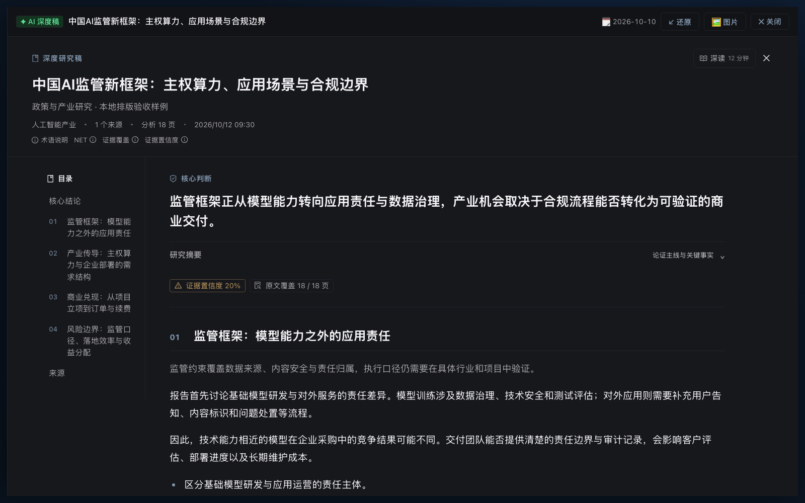

# 研报 AI 解读排版上线验收（2026-10-12）

已上线到 https://daocaijing.com。刷新网页并重新打开深度解读即可使用新版。

## 展示变化

- 将紫色大卡片改为克制的蓝灰层级，统一标题、正文、表格、逻辑线、证据和风险区块。
- 核心判断优先展示，论证主线与关键事实归入默认收起的“研究摘要”，完整文本保留。
- 目录编号与标题分列，小屏目录可横向滚动，保留章节跳转。
- 低证据置信度使用提醒色；20% 不再显示绿色成功标记。分数计算和原始证据未改变。
- 小屏操作区保留完整报告发布日期，正文保留完整标题与生成时间；两类日期明确区分。
- 打印保留摘要、正文和报告发布日期。打印事件临时展开摘要，结束后恢复原来的展开状态。

## 范围与现网基线

运行时代码仅改 `src/components/ResearchDeepDraft.tsx` 和 `src/components/ResearchDeepDraft.css`，另补对应组件测试。没有修改后端、模型或账号配置。

从当前已发布的 `skhynix-financial-release/frontend-candidate` 冻结源码构建，340 个输入逐文件核对，差异恰为上述两个组件文件和对应测试；保留现网财报修复。发布前 index 为 `fc8958c9fab364a1a7c41927fc99bbc2645c6fab67ad3e3578a5860bf4223b88`，主包为 `main.d830c5af.js`。

复用同一份依赖并关闭构建共享缓存，显式设置 `REACT_APP_TERMINAL_ONLY=true`，清除外部 `REACT_APP_*` 环境变量。最终 CRA 构建成功，React 运行时标记为 1。

## 验证

- 组件与图片导出 15 项、重试集成 17 项测试通过，共 32 项。
- 原 12 个主题/内容/尺寸组合通过，最终补测 320、390、804px：无页面横向溢出，目录、正文与来源保留，JavaScript 错误为 0。
- 小屏工具栏高约 65.3px；发布日期底部不超过工具栏底部，正文标题不重叠。样例分别使用 10 日发布日期和 12 日生成时间，防止将不同日期误当成重复信息。
- 最终 1600px 放大窗口截图通过；父容器缩放下窗口仍在视口内。
- 实际打印 PDF 三段摘要逐字完整，报告发布日期和生成时间保留，打印后分别恢复收起/展开状态；打印页面没有裁切。
- 锁内校验 161 个现网资源，先叠加资源、最后原子切换 index，保留旧 chunks 和服务器独有文件。
- 发布后 161 个资产逐文件哈希通过；首页、公开 `/ontology`、独立 `/ai-fund`、新 JS/CSS HTTP 均为 200。
- 浏览器打开 `/ontology` 实际显示公开持仓决策页面，加载新 JS/CSS，控制台错误为 0。

Nginx 会在 HTML 末尾追加既有教程和模拟盘入口，因此 HTTP HTML 哈希与磁盘 index 不同；已验证返回内容的构建前缀、新资源地址和 JS/CSS 完整哈希。

## 发布记录

| 项目 | 值 |
| --- | --- |
| JS | `static/js/main.357b82d5.js` |
| CSS | `static/css/main.c9f29ff9.css` |
| index SHA256 | `ef90882683c63ccf06c05880dd9013446e250fb62f6b193b327bfce38f228a3b` |
| JS SHA256 | `38c53499669f7b537e130e86380d091b9e042315dd3d2640c154ed4805da6388` |
| CSS SHA256 | `3cda70b0750544537928c1155f7b38d76b357cc3fe685a6f1f3fd3ddf8d93e99` |
| 备份 | `/root/deepfocus-report-layout-20261012-ef908826/web-before.tgz` |

最终源码 SHA256：TSX `9acdaa5cd9639d8b3fafd83a3aa24cb06818f77af8e0d2ee59a5d10d5a568267`；CSS `bd333247bf5d808dd466cde265d4832f893bdd47ad842fe111e318565b229489`。

验收截图使用真实 React 阅读器和冻结现网外壳样式，内容为本地排版样例。

[最终浏览器与打印检查数据](assets/research-report-layout-20261012-qa.json)。完整临时证据位于 `/tmp/deepfocus-report-layout-20261012`。
